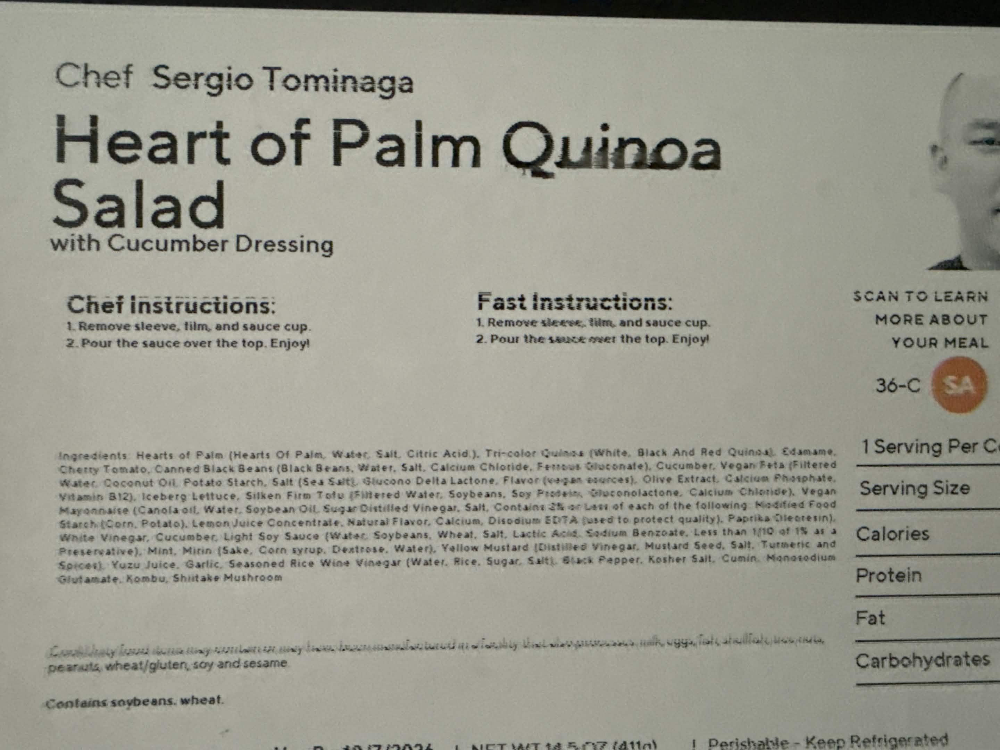

# CookUnity meal collection

14 meals collected from your open CookUnity tabs on September 8 and 10, 2026. The pages provide ingredient labels, meal descriptions, nutrition, and directions for reheating prepared meals. They do not provide ingredient quantities or recipes for cooking from scratch. Every home recipe below is an original, untested reconstruction: its quantities, yields, cooking times, component assignments, and methods are estimates unless explicitly identified as a page detail. Published nutrition describes the delivered meal only, not these home recipes. US cups and spoons are used; oven temperatures are Fahrenheit. Salt amounts refer to fine salt.

## Contents

1. [Chipotle black bean & tofu tacos](#meal-11577)
2. [Quinoa & veggie enchiladas with rice and beans](#meal-3355)
3. [Vegan vodka rigatoni with eggplant meatballs](#meal-11104)
4. [Plant-based chorizo chili quesadillas](#meal-6641)
5. [Penne with spicy pink sauce](#meal-9721)
6. [Hearts of palm quinoa salad with cucumber dressing](#meal-12797)
7. [Mexican tofu burrito bowl with avocado sauce](#meal-10053)
8. [Fettuccine with lentil bolognese](#meal-12845)
9. [Superfood bowl with sweet potato, quinoa & black beans](#meal-1450)
10. [Potato & chickpea salad with sauerkraut](#meal-ii-137539908)
11. [Kale pesto rigatoni with tomatoes & mushrooms](#meal-3621)
12. [Sun-dried tomato pesto rigatoni & Brussels sprouts](#meal-5506)
13. [Vegan chorizo chili mac & cheese](#meal-6642)
14. [Griddled veggie chimichangas with roasted potatoes](#meal-13348)

## Spicy Chipotle Black Bean & Tofu Tacos with Cashew Crema & Cilantro-Lime Slaw

Chef: **Lena Elkousy** · [CookUnity source](https://subscription.cookunity.com/products/11577)

Photo from the CookUnity meal listing; the home recipe below is a reconstruction.

**What the page establishes:** The page describes a tomato-chipotle tinga with crumbled tofu and black beans, cabbage slaw, and cashew crema. Its ingredient list also includes cumin, nutritional yeast, lemon, and red onion.

**Published ingredient names** (commercial subingredients omitted; duplicates removed): Flour Tortilla; Canned Black Beans; Canned Tomatoes; Organic Tofu; Cabbage; Onion; Cashews; Lime; Chipotle in Adobo; Red Onion; Lime Juice; Extra Virgin Olive Oil; Lemon Juice; Organic Cilantro; Tomato Paste; Garlic; Himalayan Pink Salt; Nutritional Yeast; Paprika; Cumin; Organic Granulated Garlic; Oregano; Bay Leaf.

**Delivered-meal nutrition:** 433 g portion; 700 kcal; 24 g protein; 88 g carbohydrate; 30 g fat; 12 g sugar.

**Page allergen statement:** Contains cashews, cereals containing gluten, wheat, soybeans.

### Estimated home recipe — not a published chef recipe

**Yield:** 4 servings · 8 small tacos · **Time:** About 45 minutes, plus 20 minutes to soak cashews

**Tinga filling**

- 8 small flour tortillas
- 14 oz (400 g) extra-firm tofu, drained and pressed for 15 minutes
- 1 can (15 oz) black beans, drained and rinsed
- 1 can (14–15 oz) crushed or finely chopped tomatoes
- 1 medium onion, finely diced
- 3 garlic cloves, minced
- 1 tbsp olive oil
- 1 tbsp tomato paste
- 1–2 chipotle peppers in adobo, minced, plus 1 tsp adobo sauce
- 1 tsp ground cumin
- 1 tsp paprika
- ½ tsp dried oregano
- 1 bay leaf
- ½ tsp fine salt to start

**Slaw**

- 3 cups thinly sliced green cabbage
- ¼ red onion, thinly sliced
- ¼ cup chopped cilantro
- 2 tbsp lime juice
- ¼ tsp fine salt

**Cashew crema**

- ½ cup raw cashews, soaked in hot water 20 minutes and drained
- ⅓ cup fresh water, plus more to thin
- 1 tbsp lemon juice
- 1 tbsp lime juice
- 1 tbsp nutritional yeast
- ¼ tsp garlic powder
- ¼ tsp fine salt
- Lime wedges, for serving

**Method**

1. Blend the drained cashews with fresh water, citrus juices, nutritional yeast, garlic powder, and salt until completely smooth. Add water a tablespoon at a time until it drizzles easily.
2. Toss cabbage, red onion, cilantro, lime juice, and salt. Let stand while cooking the filling; drain excess liquid before assembling.
3. Heat olive oil in a wide skillet over medium heat. Cook the onion for 5–7 minutes until softened. Add minced garlic, tomato paste, chipotle, cumin, paprika, and oregano; stir for 1 minute.
4. Crumble the tofu into roughly pea-size pieces. Add it with tomatoes, beans, bay leaf, and ½ tsp salt. Simmer uncovered for 15–20 minutes, stirring occasionally, until thick enough to sit in a tortilla without dripping. Add a splash of water if it dries before the flavors come together. Remove the bay leaf and adjust salt and heat.
5. Warm tortillas in a dry skillet for 20–30 seconds per side. Divide filling among 8 tortillas, add drained slaw, and drizzle with crema. Serve with lime wedges.

**Recipe notes:** The page gives no component quantities. Start with one chipotle for moderate heat; the second makes the filling hotter. These servings are not matched to the delivered meal’s portion or nutrition.

**Published reheating directions, paraphrased:** For the delivered meal: separate sauce, slaw, lime, and tortillas. Heat filling at 350°F for 10–15 minutes, or microwave about 2 minutes until hot. Microwave tortillas about 20 seconds, then assemble with the cold toppings.

## Quinoa & Veggie Enchiladas with Arroz Moro (Cuban Rice & Beans)

Chef: **Jose Garces** · [CookUnity source](https://subscription.cookunity.com/products/3355)

Photo from the CookUnity meal listing; the home recipe below is a reconstruction.

**What the page establishes:** The description names quinoa, kale, Oaxaca/Monterey Jack cheese, chipotle cream, and rice with black beans. The label additionally lists poblano, jalapeño, corn, cream cheese, pepper jack, cheddar, cotija, tomatoes, and other seasonings.

**Published ingredient names** (commercial subingredients omitted; duplicates removed): Heavy Cream; Poblano Peppers; Corn Tortilla; Jalapeno Peppers; Plum Tomato; Corn; Diced Canned Tomatoes; Canned Black Beans; Basmati Rice; Onion; Kale; Tri-color Quinoa; Cream Cheese; Oaxacan Cheese; Pepperjack Cheese; White Cheddar Cheese; Cilantro; Chipotle in Adobo; Extra Virgin Olive Oil; Garlic; Cotija Cheese; Cumin; Kosher Salt; Red Bell Pepper; Lemon Juice; Oil Blend; Cayenne Pepper; Avocado Oil; Monosodium Glutamate; Oregano; Bay Leaf; Vegetable Base.

**Delivered-meal nutrition:** 397 g portion; 720 kcal; 19 g protein; 66 g carbohydrate; 41 g fat; 9 g sugar.

**Page allergen statement:** Contains milk, soybeans, celery.

### Estimated home recipe — not a published chef recipe

**Yield:** 4 servings · 8 enchiladas, plus rice and beans · **Time:** About 75 minutes

**Enchiladas**

- 8 small corn tortillas
- ½ cup dry quinoa, rinsed
- 1 cup water for quinoa
- 1 tbsp olive oil, plus a little for the baking dish
- ½ medium onion, diced
- 1 poblano pepper, diced
- ½ jalapeño, minced; remove seeds for less heat
- 2 garlic cloves, minced
- 2 cups finely chopped kale, tough stems removed
- ½ cup corn
- 2 oz cream cheese
- ½ cup shredded Oaxaca cheese
- ½ cup shredded pepper jack
- ¼ tsp fine salt, then more to taste

**Chipotle cream and topping**

- 1 cup heavy cream
- ¾ cup canned diced tomatoes with juice
- 1 chipotle pepper in adobo, plus 1 tsp adobo sauce
- ¼ tsp ground cumin
- ¼ tsp fine salt
- ¼ cup shredded white cheddar
- 2 tbsp crumbled cotija
- 2 tbsp chopped cilantro

**Rice and beans**

- ½ cup dry basmati rice, rinsed
- 1 cup prepared vegetable broth
- 1 can (15 oz) black beans, drained and rinsed
- 1 tbsp olive oil
- ½ medium onion, diced
- ½ red bell pepper, diced
- 1 plum tomato, diced
- 1 garlic clove, minced
- ½ tsp ground cumin
- ¼ tsp dried oregano
- 1 bay leaf
- 1 tsp lemon juice
- Salt to taste

**Method**

1. Heat oven to 375°F and lightly oil a baking dish. Simmer quinoa with 1 cup water, covered, for about 15 minutes until absorbed. Take off heat and rest covered 5 minutes.
2. For the rice, heat 1 tbsp oil in a saucepan. Soften onion and red pepper for 5–7 minutes. Add garlic, cumin, and oregano; stir 30 seconds. Add plum tomato and cook 2 minutes. Stir in rice, broth, and bay leaf. Cover and simmer on low for 12–15 minutes, or according to the rice package. Fold in drained beans, cover, and warm on low 3–5 minutes; add a splash of water if needed. Rest off heat 5 minutes. Remove bay leaf; add lemon and salt to taste.
3. For the filling, heat 1 tbsp oil in a skillet. Cook onion, poblano, and jalapeño for 6–8 minutes. Add garlic for 30 seconds, then kale and corn. Cook 3–4 minutes until kale softens and excess moisture evaporates. Off heat, stir in quinoa, cream cheese, Oaxaca, pepper jack, and ¼ tsp salt.
4. Blend cream, canned tomatoes, chipotle, adobo, cumin, and salt. Pour into a small saucepan and gently simmer for 5 minutes, stirring. Avoid a vigorous boil.
5. Warm corn tortillas in a covered damp towel in the microwave for 30–45 seconds, until pliable. Spread a little sauce in the baking dish. Divide filling among tortillas, roll, and set seam-side down. Spoon remaining sauce over them and scatter cheddar on top.
6. Cover and bake for 15 minutes, then uncover for 5–10 minutes until bubbling at the edges. Finish with cotija and cilantro. Serve two enchiladas per person with rice and beans.

**Recipe notes:** The page refers to multiple sauce cups without identifying their separate formulas. This reconstruction uses one chipotle cream. Pepper jack follows the ingredient label; Monterey Jack is named in the description. The home version simplifies commercial oil blends and seasoning additives.

**Published reheating directions, paraphrased:** For the delivered meal: remove sauce cups and packaging film. Oven: 350°F for 12–15 minutes. Microwave: vent film and heat 2–3 minutes. Add sauces afterward.

## Vegan Pasta alla Vodka with Eggplant “Meatballs”

Chef: **Emily Peck** · [CookUnity source](https://subscription.cookunity.com/products/11104)

Photo from the CookUnity meal listing; the home recipe below is a reconstruction.

**What the page establishes:** The page describes rigatoni, tomato and roasted-red-pepper vodka sauce with cashew cream, and eggplant meatballs containing pumpkin and lentils. Spinach, panko, and nutritional yeast appear in the label.

**Published ingredient names** (commercial subingredients omitted; duplicates removed): Diced Canned Tomatoes; Rigatoni; Eggplant; Panko Breadcrumbs; Onion; Pumpkin Puree; Baby Spinach; Extra Virgin Olive Oil; Cashews; Green Lentils; Tomato Paste; Vodka; Canned Roasted Red Peppers; Basil; Garlic; Nutritional Yeast; Italian Parsley; Canola Oil; Coconut Sugar; Onion Powder; Himalayan Pink Salt; Chives; Black Pepper; Bay Leaf; Garlic Powder; Oregano; Crushed Red Pepper; Kosher Salt.

**Delivered-meal nutrition:** 383 g portion; 660 kcal; 21 g protein; 88 g carbohydrate; 24 g fat; 11 g sugar.

**Page allergen statement:** Contains cashews, cereals containing gluten, wheat.

### Estimated home recipe — not a published chef recipe

**Yield:** 4 servings · about 16 small meatballs · **Time:** About 85 minutes; use cooked lentils

**Eggplant meatballs**

- 1 medium-large eggplant, about 1 lb (450 g), cut into ¾-inch cubes
- 2 tbsp olive oil
- ½ small onion, finely diced
- 2 garlic cloves, minced
- ¾ cup cooked green lentils, well drained
- ⅓ cup plain pumpkin purée
- ¾ cup panko, plus up to ¼ cup more if needed
- 2 tbsp nutritional yeast
- 2 tbsp chopped parsley
- ½ tsp dried oregano
- ¼ tsp each garlic powder and onion powder
- ½ tsp fine salt
- ¼ tsp black pepper

**Vodka sauce**

- ½ cup raw cashews, soaked in hot water 20 minutes and drained
- ¾ cup fresh water
- 1 tbsp olive oil
- ½ small onion, finely diced
- 2 garlic cloves, minced
- 2 tbsp tomato paste
- ¼ cup vodka
- 1 can (28 oz) crushed tomatoes
- ½ cup drained roasted red peppers
- 1 bay leaf
- 2 tbsp nutritional yeast
- ¼ tsp crushed red pepper, or to taste
- ½ tsp fine salt, then more to taste
- 1 tsp coconut sugar, optional if tomatoes taste sharp

**Pasta and finishing**

- 12 oz (340 g) dry rigatoni
- 3 cups baby spinach, chopped
- ¼ cup torn basil
- 1 tbsp chopped chives
- Salt for pasta water

**Method**

1. Heat oven to 425°F. Toss eggplant with 1½ tbsp oil, spread on a baking sheet, and roast 25–30 minutes, turning once, until very soft and browned. Let cool enough to handle. Reduce oven to 400°F.
2. Heat remaining ½ tbsp meatball oil in a skillet. Soften the half onion for 5 minutes, then cook garlic 30 seconds. Pulse this mixture with roasted eggplant and lentils in a food processor until coarsely chopped, not smooth.
3. Fold in pumpkin, panko, nutritional yeast, parsley, oregano, powders, salt, and pepper. Rest 10 minutes so crumbs hydrate. The mixture should hold a ball when gently squeezed; add extra panko a tablespoon at a time if too wet. Form about 16 balls on a parchment-lined sheet. Bake 25–30 minutes at 400°F until firm and browned; turn carefully after 18 minutes. Let set on the tray for 5 minutes.
4. Meanwhile, blend drained cashews with ¾ cup fresh water until silky. In a wide saucepan, heat 1 tbsp oil and cook sauce onion for 5 minutes. Add garlic and tomato paste; cook 1–2 minutes. Take pan off the burner before adding measured vodka, then return to medium heat and simmer for 2–3 minutes.
5. Add tomatoes, roasted peppers, bay leaf, crushed red pepper, and salt. Simmer uncovered 20 minutes, stirring. Remove bay leaf, blend until smooth with an immersion blender, and stir in cashew cream and nutritional yeast. Gently simmer 3–5 minutes. Taste before adding optional sugar.
6. Boil rigatoni in salted water according to the package until al dente, reserving 1 cup pasta water. Toss pasta and spinach into the sauce over low heat until spinach wilts, adding pasta water as needed. Plate with meatballs on top, then basil and chives. Avoid simmering the soft meatballs in the sauce.

**Recipe notes:** Pumpkin and lentils help bind the eggplant, but moisture varies; the panko adjustment is an estimated home technique. This recipe has not been kitchen-tested. The listed vodka can be omitted and replaced with water for a different, alcohol-free sauce.

**Published reheating directions, paraphrased:** For the delivered meal: chop the spinach and stir it into the pasta. Heat without film at 350°F for 8–10 minutes, or microwave with vented film for about 2 minutes, until hot.

## Plant-Based 'Chorizo' Chili Quesadilla with Vegan Chile-Lime Crema

Chef: **Ivy Stark** · [CookUnity source](https://subscription.cookunity.com/products/6641)

Photo from the CookUnity meal listing; the home recipe below is a reconstruction.

**What the page establishes:** The page names vegan chorizo-and-bean chili, vegan cheddar, gluten-free tortillas, pico de gallo, and chile-lime crema. The ingredient list includes both Impossible meat and vegan chorizo, as well as vegan Parmesan.

**Published ingredient names** (commercial subingredients omitted; duplicates removed): Brown Rice Tortilla; Plum Tomato; Vegan Cheddar Cheese; Vegan Parmesan; Vegan Sour Cream; Whole Canned Tomatoes; Impossible Meat; Vegan Chorizo; Black Beans; Onion; Red Onion; Cilantro; Chipotle in Adobo; Tomato Paste; Lime Juice; Oil Blend; Garlic; Kosher Salt; Jalapeno Peppers; Serrano Peppers; Black Pepper; Cumin; Mexican Oregano; Tajin Spice.

**Delivered-meal nutrition:** 341 g portion; 530 kcal; 16 g protein; 63 g carbohydrate; 25 g fat; 5 g sugar.

**Page allergen statement:** Contains soybeans, mustard.

### Estimated home recipe — not a published chef recipe

**Yield:** 4 servings · 4 folded quesadillas · **Time:** About 45 minutes

**Chili and quesadillas**

- 4 large brown-rice or other gluten-free tortillas
- 4 oz (115 g) plant-based ground meat
- 4 oz (115 g) vegan chorizo
- ¾ cup cooked black beans, drained
- ½ medium onion, diced
- 2 garlic cloves, minced
- 1 tbsp tomato paste
- ¾ cup crushed canned tomatoes
- 1 tsp minced chipotle in adobo
- ½ tsp ground cumin
- ½ tsp Mexican oregano
- 1 tbsp neutral oil, divided
- 1 cup shredded vegan cheddar
- ¼ cup grated vegan Parmesan
- Salt and black pepper to taste

**Pico de gallo**

- 2 plum tomatoes, finely diced
- ¼ red onion, finely diced
- ½ jalapeño, minced
- ¼ serrano pepper, minced, optional for more heat
- 2 tbsp chopped cilantro
- 1 tbsp lime juice
- ¼ tsp fine salt

**Chile-lime crema**

- ½ cup vegan sour cream
- 1 tbsp lime juice
- ½ tsp Tajín
- 1–2 tsp water if needed

**Method**

1. Combine pico ingredients and set aside. Stir together crema ingredients, thinning with water if needed. Keep both cool while cooking.
2. Heat 2 tsp oil in a skillet over medium heat. Soften onion for 5 minutes. Add plant-based ground meat and chorizo; crumble and cook according to their package directions until cooked through and browned. Add garlic, tomato paste, chipotle, cumin, and oregano; stir 1 minute.
3. Add beans and crushed tomatoes. Simmer uncovered for 8–12 minutes until very thick. Mash a few beans to help bind the filling. Taste before adding salt, since the meat substitutes and cheese are seasoned. Let cool 5 minutes.
4. Warm tortillas briefly so they bend without splitting. Divide cheddar, chili, and Parmesan over one half of each tortilla, leaving a ½-inch border; fold closed.
5. Wipe the skillet and lightly brush with remaining oil. Cook quesadillas in batches over medium-low heat for about 3–4 minutes per side until crisp and the cheese melts. A lid for the first 1–2 minutes helps melt vegan cheese; uncover to finish crisping.
6. Rest 2 minutes before cutting. Serve with drained pico and chile-lime crema on the side.

**Recipe notes:** Choose gluten-free tortillas and check the meat substitutes if you want the home version to follow the page’s “No Gluten Added” specification. Component proportions are estimated; the source does not state the ratio of its two meat substitutes.

**Published reheating directions, paraphrased:** For the delivered meal: set both sauces aside. Put quesadilla on a baking sheet at 350°F for 13–15 minutes. Alternatively microwave in its vented container for 3–4 minutes, adding 30-second intervals as needed. Serve with the reserved cold sauces.

## Penne with Spicy Pink Sauce and Grana Padano Cheese

Chef: **John DeLucie** · [CookUnity source](https://subscription.cookunity.com/products/9721)

Photo from the CookUnity meal listing; the home recipe below is a reconstruction.

**What the page establishes:** The description explicitly says the sauce combines equal parts marinara and Alfredo, with crushed red pepper, grana cheese, and basil. The ingredient label lists American Grana, although the meal title says Grana Padano.

**Published ingredient names** (commercial subingredients omitted; duplicates removed): Canned Tomatoes; Penne; Heavy Cream; Butter; American Grana Cheese; Oil Blend; Shallot; Onion; Garlic; Kosher Salt; Extra Virgin Olive Oil; Sugar; Basil; Crushed Red Pepper; Black Pepper.

**Delivered-meal nutrition:** 383 g portion; 850 kcal; 21 g protein; 74 g carbohydrate; 51 g fat; 11 g sugar.

**Page allergen statement:** Contains milk, cereals containing gluten, wheat.

### Estimated home recipe — not a published chef recipe

**Yield:** 4 servings · **Time:** About 35 minutes

**Pasta**

- 12 oz (340 g) dry penne
- Salt for pasta water
- ¼ cup grated Grana Padano or American Grana, for serving
- ¼ cup torn basil

**Marinara**

- 1 tbsp olive oil
- ½ small onion, finely diced
- 2 garlic cloves, minced
- 1 can (14–15 oz) crushed tomatoes
- ½ tsp crushed red pepper, or to taste
- ¼ tsp fine salt
- ½ tsp sugar, optional
- 1 tbsp chopped basil

**Alfredo-style sauce**

- 2 tbsp butter
- 1 small shallot, finely minced
- 1 garlic clove, minced
- 1 cup heavy cream
- ½ cup finely grated Grana Padano or American Grana
- ¼ tsp black pepper

**Method**

1. Put a large pot of salted water on to boil. For marinara, heat oil in a saucepan over medium heat. Soften onion for 5–6 minutes; add garlic and red pepper and stir 30 seconds. Add tomatoes and salt, then simmer uncovered 15–20 minutes. Stir in basil. Add sugar only if the sauce tastes too acidic.
2. For the white sauce, melt butter over medium-low heat in a second saucepan. Cook shallot 3–4 minutes without browning. Add garlic for 30 seconds, then cream. Simmer gently for 3–5 minutes until slightly thickened. Remove from heat and gradually stir in ½ cup grated cheese and black pepper.
3. Measure equal volumes of red and white sauce into a wide skillet, starting with 1¼ cups of each. If one sauce yields less, use that amount of each; reserve any excess separately. This preserves the page’s stated equal-parts approach despite variation in evaporation.
4. Cook penne until al dente according to its package. Reserve 1 cup pasta water before draining. Toss pasta with the combined sauce over low heat for 1–2 minutes, adding pasta water a little at a time until glossy and loose enough to coat each piece. Avoid boiling hard after the cheese goes in.
5. Taste and adjust salt and chili. Divide among bowls, then finish with the reserved ¼ cup cheese and fresh basil.

**Recipe notes:** Equal red/white sauce proportions are stated by CookUnity; ingredient amounts and sauce preparation here are estimated. If vegetarian rennet matters to you, select a grana-style cheese explicitly labeled accordingly.

**Published reheating directions, paraphrased:** For the delivered meal: keep the cheese cup aside. Cover with foil and heat at 350°F for 12–15 minutes, stirring halfway. Or microwave with vented film for 2–3 minutes, stirring halfway. Add cheese after heating.

## Heart of Palm Quinoa Salad with Cucumber Dressing

Chef: **Sergio Tominaga** · [CookUnity source](https://subscription.cookunity.com/products/12797)

Photo from the CookUnity meal listing; the home recipe below is a reconstruction.

Package label photo supplied October 4, 2026.

**What the page establishes:** The page describes ponzu-marinated quinoa, hearts of palm, tomatoes, cucumber, crisp fried quinoa, and cucumber-tofu dressing. The label also includes edamame, black beans, vegan feta, lettuce, mint, yuzu, kombu, and shiitake.

**Published ingredient names** (commercial subingredients omitted; duplicates removed): Tri-color Quinoa; Hearts of Palm; Edamame; Cherry Tomato; Canned Black Beans; Cucumber; Vegan Feta; Silken Firm Tofu; Vegan Mayonnaise; Iceberg Lettuce; White Vinegar; Light Soy Sauce; Mint; Mirin; Yellow Mustard; Yuzu Juice; Garlic; Seasoned Rice Wine Vinegar; Black Pepper; Kosher Salt; Cumin; Monosodium Glutamate; Kombu; Shiitake Mushroom.

**Delivered-meal nutrition:** 412 g portion; 570 kcal; 21 g protein; 61 g carbohydrate; 27 g fat; 5 g sugar.

**Page allergen statement:** Contains cereals containing gluten, wheat, soybeans, mustard.

### Estimated home recipe — not a published chef recipe

**Yield:** 4 servings · **Time:** About 50 minutes, plus cooling

**Salad**

- ¾ cup dry tri-color quinoa, rinsed
- 1½ cups water
- 1 can (14 oz) hearts of palm, drained and sliced
- 1 cup shelled edamame, cooked according to package and cooled
- 1 cup canned black beans, drained and rinsed
- 1 cup halved cherry tomatoes
- 1 cup diced cucumber
- 2 cups shredded iceberg lettuce
- ½ cup crumbled vegan feta
- 2 tbsp chopped mint

**Estimated vegan ponzu**

- ¼ cup water
- 1 small dried shiitake mushroom
- 1 small piece kombu, about 2 inches square
- 2 tbsp light soy sauce
- 2 tbsp yuzu juice; lemon juice is a home substitution
- 1 tbsp mirin
- 1 tbsp seasoned rice vinegar

**Cucumber-tofu dressing**

- ½ cup silken tofu, drained
- ½ cup chopped cucumber
- 3 tbsp vegan mayonnaise
- 1 tbsp white vinegar
- 1 tsp yellow mustard
- 1 small garlic clove
- 1 tbsp mint leaves
- ⅛ tsp ground cumin
- Salt and black pepper to taste

**Crisp quinoa topping**

- ½ cup of the cooked quinoa above
- 2 tsp neutral oil (home addition; the page does not identify a frying oil)

**Method**

1. Cook quinoa with 1½ cups water: bring to a boil, cover, and simmer gently about 15 minutes until absorbed. Rest off heat, covered, for 5 minutes. Fluff, reserve ½ cup for the topping, and spread the rest on a tray to cool.
2. For ponzu, soak shiitake and kombu in ¼ cup hot water for 15 minutes. Remove solids. Combine infused water and mirin in a small saucepan; simmer 2 minutes. Cool, then add soy sauce, yuzu, and rice vinegar. This is an estimated shortcut, not the chef’s published formula.
3. Pat the reserved ½ cup cooked quinoa very dry on paper towels. Warm 2 tsp oil in a nonstick skillet over medium heat. Spread quinoa in a thin layer and cook, stirring periodically, for 8–12 minutes until dry and crisp. Lower heat if it browns too quickly. Cool on a plate.
4. Blend tofu, dressing cucumber, vegan mayonnaise, white vinegar, mustard, garlic, mint, and cumin until smooth. Taste and add salt and pepper. If thin from a watery cucumber, chill before using; if too thick, add water a teaspoon at a time.
5. Toss the cooled salad quinoa with 3 tbsp ponzu to start. Add more to taste, a tablespoon at a time, stopping before it becomes wet or overly salty; reserve any remaining ponzu.
6. Arrange lettuce in four bowls. Divide quinoa, hearts of palm, edamame, black beans, tomatoes, and diced cucumber among them. Add feta and mint, drizzle with cucumber dressing, and add crisp quinoa just before eating.

**Recipe notes:** The source does not assign every seasoning to a component. Ponzu, dressing ratios, and the skillet method for crisp quinoa are reconstructions. The listed soy sauce contains wheat. Lemon in place of yuzu and oil for the topping are explicitly identified home choices.

**Published reheating directions, paraphrased:** The delivered salad is intended to be served chilled: remove packaging and the sauce cup, then add dressing. The page gives no heating step.

## Mexican Tofu Burrito Bowl with Creamy Avocado Sauce

Chef: **Raymundo Agrazal** · [CookUnity source](https://subscription.cookunity.com/products/10053)

Photo from the CookUnity meal listing; the home recipe below is a reconstruction.

**What the page establishes:** The description names baked seasoned tofu, roasted peppers and corn, rice, black beans, and creamy avocado sauce. The label includes lemon juice, brown sugar, sriracha, cornstarch, chili powder, garlic powder, and onion powder.

**Published ingredient names** (commercial subingredients omitted; duplicates removed): Tofu; Avocado; Basmati Rice; Canned Black Beans; Red Bell Pepper; Canned Corn; Yellow Bell Pepper; Lemon Juice; Light Brown Sugar; Sriracha; Extra Virgin Olive Oil; Corn Starch; Cilantro; Oil Blend; Kosher Salt; Chili Powder; Garlic Powder; Onion Powder.

**Delivered-meal nutrition:** 369 g portion; 540 kcal; 20 g protein; 69 g carbohydrate; 21 g fat; 13 g sugar.

**Page allergen statement:** Contains soybeans.

### Estimated home recipe — not a published chef recipe

**Yield:** 4 servings · **Time:** About 50 minutes, plus 15 minutes to press tofu

**Tofu**

- 14 oz (400 g) extra-firm tofu, drained and pressed 15 minutes
- 1 tbsp olive oil
- 1 tbsp cornstarch
- 1 tsp chili powder
- ½ tsp garlic powder
- ½ tsp onion powder
- ½ tsp fine salt
- 1 tbsp sriracha
- 2 tsp light brown sugar
- 1 tbsp lemon juice

**Rice, beans, and vegetables**

- ¾ cup dry basmati rice, rinsed
- 1½ cups water, or amount specified by the rice package
- 1 can (15 oz) black beans, drained and rinsed
- 1 red bell pepper, sliced
- 1 yellow bell pepper, sliced
- 1 cup drained canned corn
- 1 tbsp olive oil
- ¼ tsp fine salt
- ¼ cup chopped cilantro

**Avocado sauce**

- 1 large ripe avocado
- 2 tbsp lemon juice
- ¼ cup water, plus more to thin
- 2 tbsp cilantro
- ¼ tsp garlic powder
- ¼ tsp fine salt

**Method**

1. Heat oven to 425°F. Cut pressed tofu into ¾-inch cubes and pat dry. Toss with 1 tbsp oil, cornstarch, chili powder, garlic powder, onion powder, and ½ tsp salt. Spread on a parchment-lined sheet with space between pieces.
2. Toss peppers and corn with their oil and ¼ tsp salt on a separate sheet. Roast tofu for 25–30 minutes, turning halfway; roast vegetables for 20–25 minutes, stirring once, until tender with browned edges.
3. Meanwhile, cook rice with its water according to package directions. Rest covered 5 minutes, then fluff. Warm beans in a small saucepan with 2 tbsp water for 4–5 minutes and drain excess liquid.
4. Mix sriracha, brown sugar, and 1 tbsp lemon juice. Toss the browned tofu with this glaze and return to the oven for 3–5 minutes, just until it clings. Watch closely so the sugar does not burn.
5. Blend avocado with 2 tbsp lemon juice, ¼ cup water, cilantro, garlic powder, and salt until creamy. Add water a tablespoon at a time until spoonable.
6. Divide rice and beans among four bowls; add roasted vegetables and tofu. Finish with cilantro and avocado sauce.

**Recipe notes:** The glaze is inferred from the listed sriracha, sugar, and lemon; the page does not say how they are used. Lemon follows the ingredient label. Quantities are estimated and do not reproduce the published packaged-meal nutrition.

**Published reheating directions, paraphrased:** For the delivered meal: reserve the sauce. Heat at 350°F for 12–15 minutes with film removed, or microwave with vented film for 2–3 minutes. Add avocado sauce after heating.

## Fettuccine Lentil Bolognese with Fresh Parsley

Chef: **Maia Bengochea** · [CookUnity source](https://subscription.cookunity.com/products/12845)

Photo from the CookUnity meal listing; the home recipe below is a reconstruction.

**What the page establishes:** The page describes lentils simmered in a tomato-pepper sauce, fettuccine, feta, and parsley. The ingredient label includes brown lentils, red pepper, white wine, paprika, oregano, and bay leaf.

**Published ingredient names** (commercial subingredients omitted; duplicates removed): Fettuccine; Canned Tomato; Brown Lentils; Organic Feta Cheese; Extra Virgin Olive Oil; Red Bell Pepper; Onion; Tomato Paste; White Wine; Organic Parsley; Garlic; Sweet Paprika; Kosher Salt; Black Pepper; Chili Powder; Oregano; Bay Leaf.

**Delivered-meal nutrition:** 409 g portion; 780 kcal; 25 g protein; 102 g carbohydrate; 28 g fat; 8 g sugar.

**Page allergen statement:** Contains milk, cereals containing gluten, wheat.

### Estimated home recipe — not a published chef recipe

**Yield:** 4 servings · **Time:** About 65 minutes using dry lentils; about 40 with cooked lentils

**Lentil sauce**

- ¾ cup dry brown lentils, rinsed and checked, or about 2 cups cooked lentils
- 3 cups water for cooking dry lentils, plus more if needed
- 2 tbsp olive oil
- 1 medium onion, finely diced
- 1 red bell pepper, finely diced
- 3 garlic cloves, minced
- 2 tbsp tomato paste
- ⅓ cup dry white wine
- 1 can (28 oz) crushed tomatoes
- 1 tsp sweet paprika
- ½ tsp dried oregano
- ¼ tsp chili powder
- 1 bay leaf
- ½ tsp fine salt, then more to taste
- ¼ tsp black pepper
- ½–1 cup water as needed for the sauce

**Pasta and finishing**

- 12 oz (340 g) dry fettuccine
- ½ cup crumbled feta
- ¼ cup chopped parsley
- Salt for pasta water

**Method**

1. If using dry lentils, place them in a saucepan with 3 cups water. Bring to a boil, then simmer gently for 20–30 minutes until tender but intact, adding water to keep them submerged. Drain. If using cooked lentils, drain and proceed.
2. Heat oil in a wide, deep skillet over medium heat. Cook onion and red pepper for 8–10 minutes until softened. Add garlic, tomato paste, paprika, oregano, and chili powder; stir for 1–2 minutes.
3. Pour in wine and simmer 2–3 minutes, scraping the bottom. Add tomatoes, cooked lentils, bay leaf, salt, pepper, and ½ cup water. Simmer uncovered for 20–25 minutes, stirring occasionally, until thick and spoon-coating. Add more water if needed to prevent sticking.
4. Mash roughly one quarter of the lentils against the pan with a spoon for a thicker texture, leaving most intact. Remove bay leaf and taste for salt.
5. Cook fettuccine in salted water according to package directions. Reserve 1 cup pasta water, then drain. Toss pasta with the sauce over low heat, adding pasta water in small splashes until it coats the noodles evenly.
6. Divide among bowls and finish with feta and parsley.

**Recipe notes:** The page’s description calls this vegan, but its label explicitly lists dairy feta and milk as an allergen, and its specification says vegetarian. This reconstruction uses dairy feta to follow the label. To make a vegan adaptation, use vegan feta and confirm the pasta and wine suit that preference.

**Published reheating directions, paraphrased:** For the delivered meal: reserve the cheese. Cover the tray with foil and heat at 350°F for 12–15 minutes, stirring halfway. Or microwave with vented film for 2–3 minutes, stirring halfway. Add cheese at the end.

## Superfood Bowl with Quinoa, Sweet Potato, & Black Beans

Chef: **Tony Perez** · [CookUnity source](https://subscription.cookunity.com/products/1450)

Photo from the CookUnity meal listing; the home recipe below is a reconstruction.

**What the page establishes:** The page describes sweet potato, quinoa, black beans, herbs, and a zesty sauce. The label specifies tomato, spinach, pumpkin seeds, white balsamic vinegar, onions, jalapeño, cilantro, chili powder, and cumin.

**Published ingredient names** (commercial subingredients omitted; duplicates removed): Sweet Potatoes; Plum Tomato; Canned Black Beans; Tri-color Quinoa; Extra Virgin Olive Oil; Red Onion; Spinach; White Balsamic Vinegar; Pumpkin Seeds; Onion; Organic Jalapeno Peppers; Kosher Salt; Organic Cilantro; Chili Powder; Cumin; Black Pepper.

**Delivered-meal nutrition:** 412 g portion; 520 kcal; 13 g protein; 65 g carbohydrate; 24 g fat; 10 g sugar.

**Page allergen statement:** No separate “Contains” statement was shown in the captured page.

### Estimated home recipe — not a published chef recipe

**Yield:** 4 servings · **Time:** About 45 minutes, plus cooling if serving chilled

**Bowl**

- 2 medium sweet potatoes, about 1 lb (450 g), peeled and cut into ¾-inch cubes
- ¾ cup dry tri-color quinoa, rinsed
- 1½ cups water
- 1 can (15 oz) black beans, drained and rinsed
- 3 plum tomatoes, diced
- 3 cups baby spinach
- ½ small yellow onion, finely diced
- ¼ red onion, finely diced
- ¼ cup pumpkin seeds
- 2 tbsp olive oil, divided
- 1 tsp chili powder
- ½ tsp ground cumin
- ½ tsp fine salt
- ¼ tsp black pepper

**Estimated cilantro–white balsamic dressing**

- 3 tbsp olive oil
- 2 tbsp white balsamic vinegar
- ¼ cup cilantro leaves
- ½ jalapeño, seeded for less heat
- 2 tbsp water
- ¼ tsp ground cumin
- ¼ tsp fine salt

**Method**

1. Heat oven to 425°F. Toss sweet potato with 1 tbsp oil, chili powder, ½ tsp cumin, ½ tsp salt, and pepper. Spread on a baking sheet and roast 25–30 minutes, turning halfway, until browned and tender in the center.
2. Bring quinoa and 1½ cups water to a boil. Cover, reduce heat, and simmer about 15 minutes until water is absorbed. Rest off heat 5 minutes, then fluff.
3. Heat remaining 1 tbsp bowl oil in a small skillet. Soften yellow onion for 4–5 minutes. Add beans and 2 tbsp water and cook 3–4 minutes until warm and most liquid has evaporated.
4. Toast pumpkin seeds in a dry skillet over medium-low heat for 2–4 minutes, stirring until fragrant. Remove from the pan immediately.
5. Blend dressing ingredients until cilantro and jalapeño are finely chopped. Taste and adjust vinegar, salt, or water for a bright, pourable sauce. Its identity and proportions are inferred from the label.
6. For a chilled bowl like the delivered meal, spread cooked components in shallow containers and refrigerate promptly until cool. Divide spinach among four bowls, then add quinoa, sweet potato, beans, tomatoes, and red onion. Spoon on dressing and finish with pumpkin seeds. You may also assemble with freshly cooked warm components for a home variation.

**Recipe notes:** The page does not identify the zesty sauce by name or supply a formula. The cilantro–white balsamic dressing is a proposed reconstruction based on the listed ingredients.

**Published reheating directions, paraphrased:** The delivered bowl’s instructions call for removing packaging and adding sauce, with no heating step.

## Potato & Chickpea Salad with Sauerkraut & Dijon Dressing

Chef: **Lena Elkousy** · [CookUnity source](https://subscription.cookunity.com/products/ii-137539908?date=2026-10-03)

Photo from the CookUnity meal listing; the home recipe below is a reconstruction.

**What the page establishes:** The page names Yukon potatoes, chickpeas, sauerkraut, kale, green beans, fresh herbs, lemon-mustard dressing, and toasted pumpkin and sunflower seeds. The title says Dijon; the ingredient label specifies whole grain mustard.

**Published ingredient names** (commercial subingredients omitted; duplicates removed): Yukon Potatoes; Canned Organic Chickpeas; Sauerkraut; Green Beans; Red Onion; Extra Virgin Olive Oil; Organic Kale; Pumpkin Seeds; Sunflower Seeds; Lemon Juice; Whole Grain Mustard; Organic Parsley; Dill; Himalayan Pink Salt; Black Pepper; Granulated Garlic; Kosher Salt.

**Delivered-meal nutrition:** 412 g portion; 590 kcal; 14 g protein; 43 g carbohydrate; 41 g fat; 6 g sugar.

**Page allergen statement:** Contains mustard.

### Estimated home recipe — not a published chef recipe

**Yield:** 4 servings · **Time:** About 40 minutes, plus chilling

**Salad**

- 1 lb (450 g) Yukon Gold potatoes, cut into ¾-inch pieces
- 1 can (15 oz) chickpeas, drained and rinsed
- 1 cup sauerkraut, drained but not squeezed completely dry
- 6 oz (170 g) green beans, trimmed and cut into bite-size pieces
- 2 cups finely chopped kale, tough stems removed
- ¼ cup finely diced red onion
- ¼ cup chopped parsley
- 2 tbsp chopped dill
- 1 tsp olive oil for softening kale
- Salt for potato water

**Lemon-mustard dressing**

- ¼ cup extra virgin olive oil
- 3 tbsp lemon juice
- 1½ tbsp whole grain Dijon mustard
- ¼ tsp granulated garlic
- ¼ tsp black pepper
- Salt to taste, after mixing with sauerkraut

**Seed topping**

- ¼ cup pumpkin seeds
- ¼ cup sunflower seeds

**Method**

1. Cover potatoes with cold, lightly salted water in a saucepan. Bring to a gentle boil and cook for 10–14 minutes, until a knife slides in easily but the pieces hold their shape. Drain well and spread on a tray to release steam.
2. Meanwhile, boil green beans in a separate pan for 3–4 minutes until bright and crisp-tender. Transfer to ice water, then drain and pat dry. Massage chopped kale with 1 tsp olive oil for 1–2 minutes to soften it.
3. Whisk together dressing oil, lemon juice, mustard, granulated garlic, and pepper. Toss the still-warm potatoes with 2 tbsp of the dressing so they take on some flavor. Refrigerate in a shallow container until chilled.
4. Toast pumpkin and sunflower seeds in a dry skillet over medium-low heat for 3–5 minutes, stirring often, until fragrant and lightly golden. Transfer to a plate to cool.
5. Gently fold chilled potatoes with chickpeas, drained sauerkraut, green beans, kale, red onion, parsley, and dill. Add half of the remaining dressing, taste, and add more as needed. Check salt only after adding the sauerkraut and mustard.
6. Serve cold with the seed mixture sprinkled on top. Keep any remaining dressing and seeds separate until serving so the salad stays crisp.

**Recipe notes:** Dressing proportions and component amounts are estimated. Whole grain Dijon follows both the title and ingredient label. The source URL identifies a dated inventory listing for October 3, 2026; no numeric product ID was visible in the URL.

**Published reheating directions, paraphrased:** The delivered meal is served cold. The page specifies no heating step.

## Rigatoni with Kale Pesto with Roasted Tomatoes & Mushroom

Chef: **Lena Elkousy** · [CookUnity source](https://subscription.cookunity.com/products/3621)

Photo from the CookUnity meal listing; the home recipe below is a reconstruction.

**What the page establishes:** The description identifies roasted kale blended with almonds, lemon, garlic, and basil, tossed with rigatoni and served with roasted cherry tomatoes and mushrooms. Nutritional yeast appears in the ingredient list.

**Published ingredient names** (commercial subingredients omitted; duplicates removed): Rigatoni; Crimini Mushroom; Cherry Tomato; Organic Kale; Extra Virgin Olive Oil; Almonds; Basil; Lemon Juice; Nutritional Yeast; Himalayan Pink Salt; Garlic; Granulated Garlic; Kosher Salt.

**Delivered-meal nutrition:** 412 g portion; 900 kcal; 25 g protein; 82 g carbohydrate; 56 g fat; 8 g sugar.

**Page allergen statement:** Contains almonds, cereals containing gluten, wheat.

### Estimated home recipe — not a published chef recipe

**Yield:** 4 servings · **Time:** About 45 minutes

**Pasta and roasted vegetables**

- 12 oz (340 g) dry rigatoni
- 12 oz (340 g) cremini mushrooms, quartered
- 1 pint cherry tomatoes, about 10 oz (280 g)
- 2 tbsp extra virgin olive oil
- ¼ tsp granulated garlic
- ½ tsp fine salt, divided between the vegetables
- Salt for pasta water

**Roasted kale pesto**

- 4 packed cups kale leaves, stems removed and leaves torn, about 4 oz (115 g)
- 1 tsp olive oil for roasting kale
- ½ cup raw unsalted almonds
- 1 packed cup basil leaves
- ⅓ cup extra virgin olive oil
- 3 tbsp lemon juice
- 2 garlic cloves, roughly chopped
- 3 tbsp nutritional yeast
- ¼ tsp fine salt, then more to taste
- ¼ cup water, plus more as needed

**Method**

1. Heat oven to 425°F. Toss mushrooms with 1 tbsp oil, granulated garlic, and ¼ tsp salt. Toss tomatoes with the other tablespoon oil and ¼ tsp salt. Spread them on opposite halves of a large sheet, or separate sheets if crowded. Roast for 20–25 minutes, stirring the mushrooms halfway, until browned and the tomatoes have blistered.
2. Toss kale with its 1 tsp oil on another tray. Roast for 5–8 minutes, tossing once, just until wilted with a few browned edges. Watch closely and remove it before it becomes brittle or scorched. Let cool briefly.
3. Toast almonds in a dry skillet over medium-low heat for 4–6 minutes, stirring, then cool. Pulse almonds and garlic in a food processor until finely chopped. Add roasted kale, basil, lemon juice, nutritional yeast, salt, and ¼ cup water. Process while slowly adding ⅓ cup olive oil, scraping the bowl as needed, to make a thick pesto.
4. Boil rigatoni in salted water according to its package until al dente. Reserve 1½ cups pasta water before draining.
5. Return pasta to the warm pot off heat. Add pesto and ½ cup pasta water, then toss thoroughly. Add more pasta water a few tablespoons at a time until the pesto coats the pasta without clumping. Taste and adjust lemon or salt.
6. Fold in half the roasted vegetables. Divide pasta among bowls and top with the remaining vegetables and their pan juices. Serve immediately.

**Recipe notes:** The source specifies roasted kale, so this reconstruction briefly roasts it before blending. Roast times, quantities, and pesto texture adjustments are estimated. The published 900 calories are for the delivered meal, not a serving of this home version.

**Published reheating directions, paraphrased:** For the delivered meal: remove the film and heat at 350°F for 12–15 minutes, or microwave with vented film for 2–3 minutes. Stir halfway and add a spoonful of water if the pasta seems dry.

## Sun-Dried Tomato Almond Pesto Rigatoni with Crispy Roasted Brussels Sprouts

Chef: **Lena Elkousy** · [CookUnity source](https://subscription.cookunity.com/products/5506)

Photo from the CookUnity meal listing; the home recipe below is a reconstruction.

**What the page establishes:** The page describes almond pesto made with sun-dried tomatoes, basil, garlic, and olive oil, tossed with rigatoni and paired with deeply roasted Brussels sprouts. Lemon, nutritional yeast, and parsley also appear in the label.

**Published ingredient names** (commercial subingredients omitted; duplicates removed): Brussel Sprouts; Rigatoni; Extra Virgin Olive Oil; Sun Dried Tomatoes; Almonds; Lemon Juice; Basil; Nutritional Yeast; Garlic; Himalayan Pink Salt; Italian Parsley; Kosher Salt.

**Delivered-meal nutrition:** 383 g portion; 880 kcal; 26 g protein; 90 g carbohydrate; 50 g fat; 6 g sugar.

**Page allergen statement:** Contains almonds, cereals containing gluten, wheat, sulphur dioxide and sulphites.

### Estimated home recipe — not a published chef recipe

**Yield:** 4 servings · **Time:** About 40 minutes

**Pasta and Brussels sprouts**

- 12 oz (340 g) dry rigatoni
- 1 lb (450 g) Brussels sprouts, trimmed and halved; quarter large ones
- 2 tbsp extra virgin olive oil
- ½ tsp fine salt
- 2 tbsp chopped parsley
- Salt for pasta water

**Sun-dried tomato almond pesto**

- ¾ cup drained oil-packed sun-dried tomatoes, about 4 oz (115 g)
- ½ cup raw unsalted almonds
- 1 packed cup basil leaves
- 2 garlic cloves, roughly chopped
- ⅓ cup extra virgin olive oil
- 2 tbsp lemon juice
- 3 tbsp nutritional yeast
- ¼ cup warm water, plus more as needed
- ¼ tsp fine salt, only if needed after tasting

**Method**

1. Heat oven to 425°F. Toss Brussels sprouts with 2 tbsp oil and ½ tsp salt. Arrange cut-side down on a large baking sheet with space between pieces. Roast for 22–30 minutes until the cut sides are deeply browned and the centers tender. Turn any loose leaves early if they darken too quickly.
2. Toast almonds in a dry skillet over medium-low heat for 4–6 minutes, stirring frequently. Let cool. If using dry-packed tomatoes instead of oil-packed, soak them in hot water for 15 minutes and drain before measuring.
3. Pulse almonds and garlic in a food processor until finely chopped. Add sun-dried tomatoes, basil, lemon juice, nutritional yeast, and ¼ cup warm water. Process while drizzling in ⅓ cup oil. Scrape down the bowl and blend to a textured paste. Taste before adding salt; tomatoes may already be salty.
4. Cook rigatoni in salted water according to the package until al dente. Reserve 1½ cups pasta water before draining.
5. Off heat, toss pasta with pesto and ½ cup pasta water. Add more pasta water a little at a time until the sauce is glossy and clings to the rigatoni. Taste for salt and lemon.
6. Divide among bowls and sprinkle with parsley. Serve Brussels sprouts alongside or on top just before eating to preserve their crisp edges.

**Recipe notes:** The label does not identify whether the sun-dried tomatoes are oil-packed; that is a home choice. It lists sulphur dioxide and sulphites as allergens in addition to almonds and wheat. Unrelated customer reviews on the page were excluded from recipe development.

**Published reheating directions, paraphrased:** For the delivered meal: heat with film removed at 350°F for 12–15 minutes, or microwave with vented film for 2–3 minutes. Stir halfway and add a spoonful of water if dry.

## Plant-Based 'Chorizo' Chili Mac & Cheese with Vegan Parmesan Bread Crumbs

Chef: **Ivy Stark** · [CookUnity source](https://subscription.cookunity.com/products/6642)

Photo from the CookUnity meal listing; the home recipe below is a reconstruction.

**What the page establishes:** The page describes fusilli in vegan cheese sauce with spicy vegan chorizo chili, Parmesan-style breadcrumbs, and pico de gallo. The ingredient label includes potato, carrot, nutritional yeast, cornstarch, vegan cheddar, and both Impossible meat and vegan chorizo.

**Published ingredient names** (commercial subingredients omitted; duplicates removed): Fusilli; Vegan Cheddar Cheese; Potato; Plum Tomato; Whole Canned Tomatoes; Carrots; Panko Breadcrumbs; Vegan Parmesan; Impossible Meat; Vegan Chorizo; Oil Blend; Black Beans; Nutritional Yeast; Onion; Red Onion; Lemon Juice; Cilantro; Chipotle in Adobo; Tomato Paste; Corn Starch; Lime Juice; Kosher Salt; Garlic; Jalapeno Peppers; Serrano Peppers; Garlic Powder; Black Pepper; Sweet Paprika; Onion Powder; Cumin; Mexican Oregano.

**Delivered-meal nutrition:** 383 g portion; 740 kcal; 21 g protein; 111 g carbohydrate; 26 g fat; 5 g sugar.

**Page allergen statement:** Contains wheat, soybeans, mustard.

### Estimated home recipe — not a published chef recipe

**Yield:** 4 generous servings · **Time:** About 65 minutes

**Pasta and cheese sauce**

- 10 oz (280 g) dry fusilli
- 1 medium potato, peeled and diced, about 6 oz (170 g)
- 1 medium carrot, peeled and thinly sliced, about 3 oz (85 g)
- 1 cup shredded vegan cheddar
- ¼ cup nutritional yeast
- 1 tbsp lemon juice
- 1 tbsp neutral oil
- 1 tsp cornstarch
- ½ tsp each garlic powder and onion powder
- ½ tsp sweet paprika
- ¼ tsp fine salt, then more to taste
- ¾ cup reserved vegetable cooking water, plus more to thin
- Salt for pasta water

**Chorizo chili**

- 4 oz (115 g) plant-based ground meat
- 4 oz (115 g) vegan chorizo
- ½ cup cooked black beans, drained
- ½ medium onion, finely diced
- 2 garlic cloves, minced
- 1 tsp neutral oil
- 1 tbsp tomato paste
- ¾ cup crushed canned tomatoes
- 1 tsp minced chipotle in adobo
- ½ tsp ground cumin
- ½ tsp Mexican oregano
- Salt and black pepper to taste

**Breadcrumb topping**

- ½ cup panko breadcrumbs
- ¼ cup grated vegan Parmesan
- 1 tbsp neutral oil

**Pico de gallo**

- 2 plum tomatoes, diced
- ¼ red onion, finely diced
- ½ jalapeño, minced
- ¼ serrano pepper, minced, optional for more heat
- 2 tbsp chopped cilantro
- 1 tbsp lime juice
- ¼ tsp fine salt

**Method**

1. Heat oven to 375°F. Cover potato and carrot with water in a saucepan and simmer 12–15 minutes until very tender. Reserve at least 1½ cups cooking water, then drain the vegetables.
2. For the chili, heat 1 tsp oil in a skillet over medium heat. Cook onion 5 minutes, then add ground meat substitute and chorizo. Crumble and cook through according to their package directions. Add garlic, tomato paste, chipotle, cumin, and oregano; stir 1 minute. Add tomatoes and beans, then simmer uncovered 8–10 minutes until thick. Taste for salt and pepper.
3. Blend cooked potato and carrot with ¾ cup reserved cooking water, nutritional yeast, lemon juice, sauce oil, cornstarch, garlic and onion powders, paprika, and ¼ tsp salt. Return to the saucepan and gently simmer, stirring, for 2 minutes so the cornstarch thickens. Add vegan cheddar and stir over low heat until melted. Thin with reserved cooking water as needed; it should pour easily, since baking thickens it further.
4. Cook fusilli in salted water for 2 minutes less than the package’s al dente time. Drain, retaining ½ cup pasta water. Toss with cheese sauce, then fold in the chili. If the mixture seems tight, add a little pasta water. Transfer to a roughly 2½-quart baking dish.
5. Mix panko, vegan Parmesan, and topping oil. Scatter over the pasta. Bake uncovered for 15–20 minutes until hot throughout and the crumbs are golden. Keep an eye on the topping near the end.
6. Meanwhile, combine pico ingredients and let stand 10 minutes; drain excess liquid. Rest baked pasta for 5 minutes, then serve with pico on the side or spooned over each portion.

**Recipe notes:** The potato-carrot sauce is inferred from the ingredients; CookUnity does not publish its sauce formula or the ratio of the two meat substitutes. These are generous home portions, not replicas of the delivered 383 g portion. Ingredient amounts and baking instructions are untested estimates.

**Published reheating directions, paraphrased:** For the delivered meal: remove the condiment cups, add the breadcrumb topping, and heat with film removed at 350°F for 12–15 minutes. Alternatively add crumbs and microwave with vented film for 3–4 minutes. Add pico de gallo after heating.

## Griddled Veggie Chimichanga with Roasted Potatoes

Chef: **Raymundo Agrazal** · [CookUnity source](https://subscription.cookunity.com/products/13348)

Photo from the CookUnity meal listing; the home recipe below is a reconstruction.

**What the page establishes:** The page describes griddled burritos filled with refried black beans, corn, roasted red pepper, white onion, and cheddar, served with roasted red potatoes and avocado aioli. The label also includes lemon, mayonnaise, garlic, taco seasoning, and Italian herbs.

**Published ingredient names** (commercial subingredients omitted; duplicates removed): Flour Tortilla; Potato; Canned Black Beans; Onion; Canned Roasted Red Peppers; Corn; Mild Cheddar Cheese; Avocado; Mayonnaise; Oil Blend; Lemon Juice; Garlic; Taco Seasoning; Kosher Salt; Canola Oil; Black Pepper; Italian Herb Seasoning.

**Delivered-meal nutrition:** 412 g portion; 800 kcal; 24 g protein; 82 g carbohydrate; 44 g fat; 10 g sugar.

**Page allergen statement:** Contains milk, eggs, barley, wheat, soybeans.

### Estimated home recipe — not a published chef recipe

**Yield:** 4 servings · 4 burritos with potatoes and dip · **Time:** About 50 minutes

**Chimichangas**

- 4 large burrito-size flour tortillas, 10–12 inches
- 1 can (15 oz) black beans, drained and rinsed
- 1 small white onion, finely diced
- ¾ cup corn, drained or thawed
- ¾ cup jarred roasted red peppers, drained, patted dry, and diced
- 1 cup shredded mild cheddar
- 2 garlic cloves, minced
- 1½ tsp taco seasoning
- 1 tbsp neutral oil for filling, plus 2 tsp for griddling
- ¼ cup water
- Salt to taste

**Roasted potatoes**

- 1 lb (450 g) red potatoes, cut into ¾-inch pieces
- 1½ tbsp neutral oil
- 1 tsp Italian herb seasoning
- ½ tsp fine salt
- ¼ tsp black pepper

**Avocado aioli**

- 1 ripe avocado
- ¼ cup mayonnaise
- 1½ tbsp lemon juice
- 1 small garlic clove, grated
- 2 tbsp water, plus more to thin
- Salt to taste

**Method**

1. Heat oven to 425°F. Toss potato pieces with their oil, Italian herbs, salt, and pepper. Spread on a baking sheet and roast 25–35 minutes, turning halfway, until browned and tender.
2. Heat 1 tbsp filling oil in a skillet over medium heat. Cook onion for 5–7 minutes until soft. Add minced garlic and taco seasoning, stirring for 30 seconds. Add beans and ¼ cup water; simmer 3–5 minutes while mashing most of the beans to make a thick spread.
3. Fold in corn and well-drained roasted peppers. Cook for 2–3 minutes until excess moisture evaporates. Taste before salting, since taco seasoning may contain salt. Remove from heat and let cool for 5 minutes.
4. Blend avocado, mayonnaise, lemon juice, grated garlic, and 2 tbsp water until smooth. Add more water a teaspoon at a time if needed to make a dip. Taste and adjust salt.
5. Warm tortillas briefly in a dry skillet or under a damp towel in the microwave until flexible. Divide filling among them, keeping it in the lower center and leaving a wide border. Add ¼ cup cheddar to each. Fold the sides inward, bring the lower edge over the filling, and roll snugly to enclose.
6. Brush a large skillet with the remaining 2 tsp oil. Cook burritos in batches over medium-low heat, seam-side down first, for 3–4 minutes per side until golden and the cheese melts. If browning before the center is hot, lower the heat and cover briefly. Serve with roasted potatoes and avocado aioli.

**Recipe notes:** The home method follows the description’s griddled preparation. Mayonnaise and cheddar make this a vegetarian recipe with egg and dairy, rather than vegan. Quantities, seasonings, and sauce ratios are estimated.

**Published reheating directions, paraphrased:** For the delivered meal: reserve the sauce cup. Heat with film removed at 350°F for 12–15 minutes, or microwave with vented film for 2–3 minutes. Serve the sauce as a dip.

## Source and preparation notes

The complete ingredient-label text, including commercial subingredients, is preserved in `source-details.json`. Cooking directions above are independently written. Reheating directions apply to the original delivered meals; their short heating times should not be used as from-scratch cooking times. CookUnity gives a shared-facility notice for milk, eggs, fish, shellfish, tree nuts, peanuts, wheat/gluten, soy, and sesame. Ingredient labels on the products you buy govern your home version.